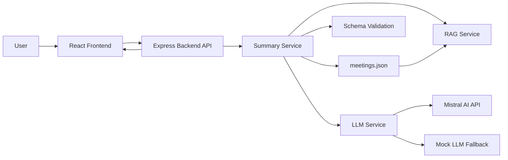
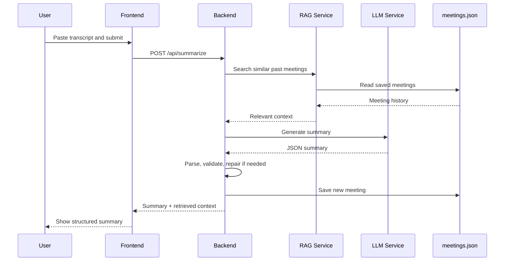
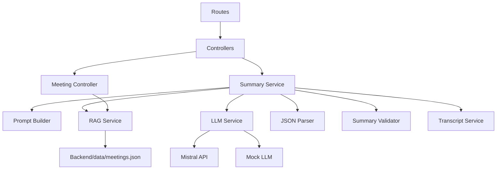
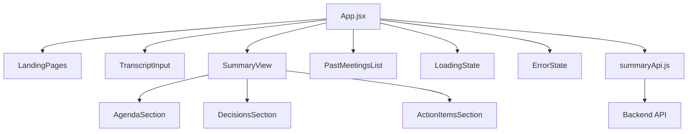
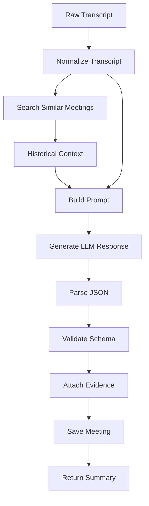
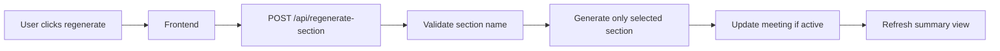

# MeetSummarizer AI System Design

This document explains how the MeetSummarizer AI project works, how it is designed, how data moves through the system, and how the main parts interact with each other.

## Our Project

MeetSummarizer AI is a web application that converts meeting transcripts into structured meeting summaries.

The user pastes a transcript into the frontend dashboard. The backend processes the transcript, optionally sends it to Mistral AI, validates the returned JSON, adds evidence where possible, saves the meeting, and returns the final summary to the frontend.

The generated summary contains:

- Agenda topics
- Decisions
- Action items
- Owners
- Due dates
- Evidence from the transcript when available

The project also stores previous meetings in a local JSON file. These previous meetings are used as historical context so the system can keep continuity across related meetings.

## High-Level Design

The system has two main applications:

- Frontend: React + Vite application used by the user.
- Backend: Node.js + Express API that handles summarization, storage, validation, and meeting history.

The backend can run in two modes:

- Mistral mode: Uses the configured Mistral API key.
- Mock mode: Uses the local mock LLM service when no valid API key is available.

## System Architecture



ASCII view:

```text
User
  |
  v
React Frontend
  |
  v
Express Backend API
  |
  +--> Summary Service
        |
        +--> RAG Service reads previous meetings
        +--> LLM Service calls Mistral or Mock LLM
        +--> Validator normalizes output
        +--> meetings.json stores result
```

## How The System Is Working

1. The user enters a meeting transcript in the frontend.
2. The frontend sends the transcript to `POST /api/summarize`.
3. The backend normalizes the transcript.
4. The RAG service searches previous meetings in `Backend/data/meetings.json`.
5. Similar previous meetings are formatted as historical context.
6. The summary prompt is built using the current transcript and historical context.
7. The LLM service decides whether to use Mistral AI or the mock summarizer.
8. The LLM returns JSON text.
9. The backend parses and validates the JSON.
10. If JSON parsing or validation fails, the backend asks the LLM to repair the response.
11. The backend adds transcript evidence to action items where possible.
12. The meeting is saved into `meetings.json`.
13. The final summary is returned to the frontend.
14. The frontend displays the agenda, decisions, action items, and retrieved context.

## Request Flow



## How The System Is Designed

The system is designed in layers so each part has a clear responsibility.

### Frontend Layer

The frontend is responsible for:

- Showing landing pages and the dashboard.
- Accepting transcript input.
- Calling backend APIs.
- Displaying loading and error states.
- Showing generated summaries.
- Allowing edits to summary sections.
- Regenerating selected sections.
- Showing saved past meetings.

Important frontend files:

```text
Frontend/src/App.jsx
Frontend/src/api/summaryApi.js
Frontend/src/components/TranscriptInput.jsx
Frontend/src/components/SummaryView.jsx
Frontend/src/components/PastMeetingsList.jsx
Frontend/src/components/AgendaSection.jsx
Frontend/src/components/DecisionsSection.jsx
Frontend/src/components/ActionItemsSection.jsx
```

### Backend API Layer

The backend API layer receives HTTP requests and sends responses.

Important backend route files:

```text
Backend/src/routes/index.js
Backend/src/routes/summaryRoutes.js
Backend/src/routes/meetingRoutes.js
Backend/src/routes/landingRoutes.js
```

Main API endpoints:

```text
GET    /api/health
GET    /api/landing
POST   /api/summarize
POST   /api/regenerate-section
GET    /api/meetings
PUT    /api/meetings/:id
DELETE /api/meetings/:id
```

### Controller Layer

Controllers connect routes to services.

Important controller files:

```text
Backend/src/controllers/summaryController.js
Backend/src/controllers/meetingController.js
Backend/src/controllers/healthController.js
Backend/src/controllers/landingController.js
```

Controllers are kept thin. They receive request data, call services, and return JSON responses.

### Service Layer

The service layer contains the main business logic.

Important service files:

```text
Backend/src/services/summaryService.js
Backend/src/services/llmService.js
Backend/src/services/mockLlmService.js
Backend/src/services/ragService.js
Backend/src/services/transcriptService.js
```

Responsibilities:

- `summaryService.js`: Main summarization workflow.
- `llmService.js`: Calls Mistral AI or chooses mock mode.
- `mockLlmService.js`: Local demo summarizer.
- `ragService.js`: Stores meetings and finds similar previous meetings.
- `transcriptService.js`: Normalizes transcript text and finds evidence.

### Validation Layer

The backend validates LLM output before sending it to the frontend.

Important validation file:

```text
Backend/src/validators/summarySchema.js
```

The expected summary shape is:

```json
{
  "agenda": ["topic explicitly discussed"],
  "decisions": ["decision explicitly made"],
  "action_items": [
    {
      "owner": "person explicitly assigned, or null",
      "task": "task explicitly assigned",
      "due_date": "deadline explicitly mentioned, or null",
      "evidence": "supporting transcript sentence, or null"
    }
  ]
}
```

## Backend Component Design



## Frontend Component Design



## Data Flow Design



## How RAG Is Working

RAG means the backend uses previous saved meetings as extra context for the current transcript.

In this project, RAG is file-based:

1. Previous meetings are stored in `Backend/data/meetings.json`.
2. The current transcript is tokenized.
3. Saved meetings are tokenized.
4. The backend calculates basic TF-IDF similarity.
5. The most similar previous meetings are selected.
6. These meetings are added to the prompt as historical context.
7. The current transcript remains the primary source of truth.

The system is instructed not to invent new facts. Historical context is used only for continuity.

## How Summary Regeneration Works

The user can regenerate only one section instead of regenerating the full summary.

Supported sections:

- `agenda`
- `decisions`
- `action_items`

Flow:



## How Meeting History Works

The sidebar loads saved meetings from:

```text
GET /api/meetings
```

The user can:

- Select a past meeting.
- Edit its summary.
- Delete it.
- Use past meetings indirectly as RAG context for future summaries.

Meeting updates use:

```text
PUT /api/meetings/:id
```

Meeting deletion uses:

```text
DELETE /api/meetings/:id
```

## How Things Are Going In The Current Project

Current implemented status:

- Frontend dashboard is implemented.
- Landing pages are implemented.
- Backend Express API is implemented.
- Summary generation is implemented.
- Mistral integration is implemented.
- Mock LLM fallback is implemented.
- JSON validation and repair flow is implemented.
- File-based RAG is implemented.
- Meeting save, update, list, and delete are implemented.
- Local JSON storage is implemented.

Current limitations:

- There are no automated test scripts configured.
- Storage is local JSON, not a database.
- RAG uses basic TF-IDF similarity, not embeddings.
- Authentication is not implemented.
- Multi-user support is not implemented.
- Real AI quality depends on a valid Mistral API key.

## Runtime Modes

```mermaid
flowchart TD
  Start[Backend Starts] --> CheckKey{Valid Mistral API key?}
  CheckKey -->|Yes| Mistral[Mistral Mode]
  CheckKey -->|No| Mock[Mock Demo Mode]
  Mistral --> Health1[/api/health returns llmMode: mistral]
  Mock --> Health2[/api/health returns llmMode: mock]
```

## Summary

MeetSummarizer AI is designed as a clean full-stack application with a React frontend and an Express backend. The frontend handles user interaction, while the backend owns the summarization pipeline, validation, RAG retrieval, and meeting storage.

The system is currently working as a local AI meeting summarizer with both real Mistral support and mock demo support. Its design is modular, so future improvements like database storage, authentication, embeddings, and automated tests can be added without rewriting the full application.
